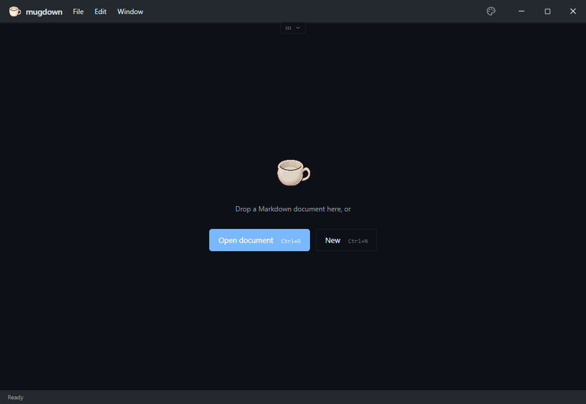
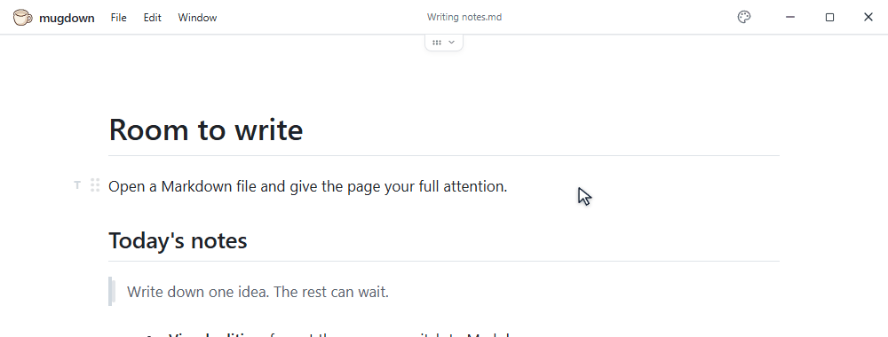
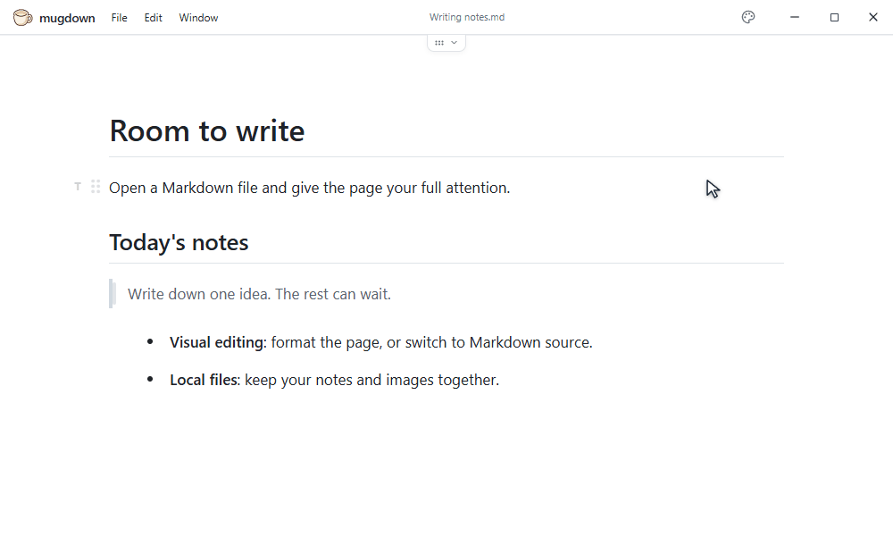
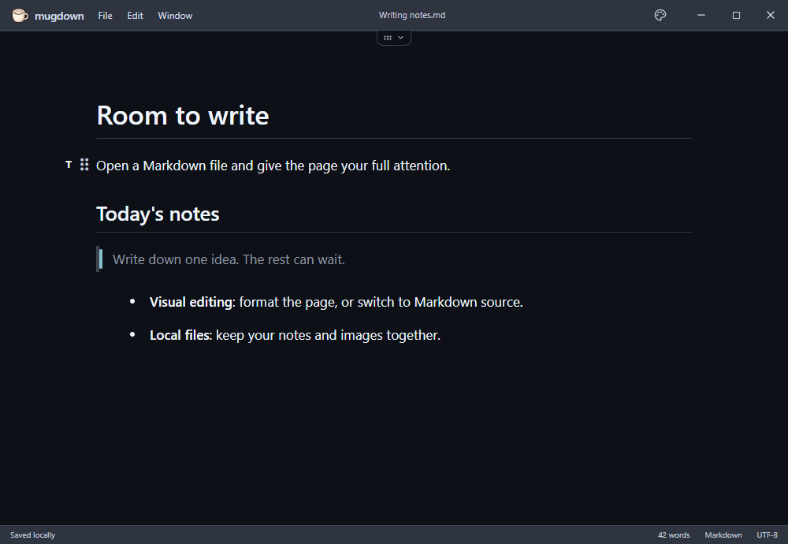
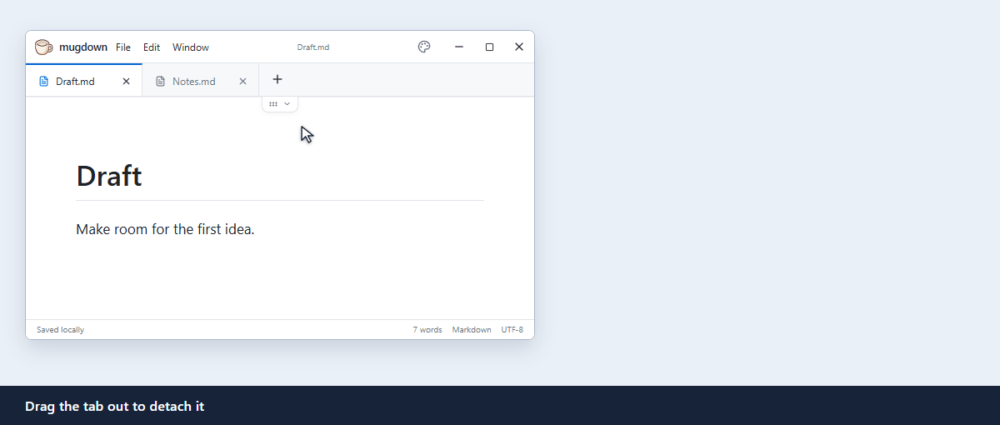

<div align="center">
  
  <h1>mugdown</h1>
  <p>A tiny, minimal editor for local Markdown files.</p>
  <p><strong>Windows x64 portable · ZIP about 2.5 MB · <a href="README.md">简体中文</a> / <a href="README.en.md">English</a></strong></p>
  <p><a href="https://github.com/winotmk/mugdown/releases/latest"><strong>Download</strong></a> · <a href="#quick-start">Quick start</a> · <a href="#build-from-source">Build from source</a></p>
</div>



mugdown opens and saves ordinary `.md` files on your computer. There is no account or document library to set up. The window has no sidebar, and the tab bar stays out of sight until you open a second document.

The Windows x64 portable ZIP is about **2.5 MB**; the executable is about **4.2 MB**. It uses the system's WebView2 runtime, so the package doesn't need to include a browser.

| Desktop platform | System webview | Status |
| --- | --- | --- |
| Windows x64 | WebView2 | [Portable download available](https://github.com/winotmk/mugdown/releases/latest) |
| macOS (Apple Silicon / Intel) | WKWebView | Universal build configured; awaiting testing on a Mac |
| Desktop Linux | WebKitGTK | The architecture is portable; platform integration and testing are pending |

## Design

### A toolbar that appears when you need it

Hover over the small handle at the top to reveal the toolbar. Move away to hide it, or click the pin to keep it visible. Selecting text brings up formatting tools next to the selection.



### Choose the interface theme and document style separately

Use the palette button in the top right to switch interface themes. The document has its own styles: choose one of seven presets or add your own CSS.



<details>
<summary>See the editor in Nord dark mode</summary>



</details>

### Detach a tab, then merge the window back

With two documents open, drag a tab outside the window to give it a window of its own. To merge it back, grab an empty area of the detached window's title bar, drag it over the other mugdown window, and release when the destination is highlighted.



## Quick start

1. Download the Windows x64 portable ZIP from [Releases](https://github.com/winotmk/mugdown/releases).
2. Extract it to a folder you can write to and run `mugdown.exe`. If WebView2 is missing, [download it from Microsoft](https://developer.microsoft.com/microsoft-edge/webview2/#download-section).
3. Drop a Markdown file into the window or press <kbd>Ctrl</kbd> + <kbd>O</kbd>. Use <kbd>Ctrl</kbd> + <kbd>S</kbd> to save and <kbd>Ctrl</kbd> + <kbd>/</kbd> to switch between visual editing and Markdown source.

- **Arrange blocks:** Hover to the left of a block to change its type or drag it into a new position.
- **Edit HTML:** HTML in a Markdown file renders in visual mode, with a label on standalone HTML blocks. To add one, choose **Insert HTML block** from the block menu, enter the source, and click **Apply**. Saving preserves the HTML source.
- **Keep images with your document:** Images pasted into a saved document go into a matching folder next to the file. Take that folder with you when you move the document.
- **Keep your preferences:** Settings live in `settings.json` next to the executable by default. You can switch to the system settings directory in Appearance. When upgrading the portable version, copy your settings and any custom `presets` to the new folder.

[Add document style presets](docs/presets.md) · [Add an interface language](docs/i18n.md) (Chinese)

## Architecture

**Tauri 2 + Rust** provide the desktop shell and handle file access, windows, the clipboard, and settings. **React + TypeScript** power the interface, with **Milkdown** for visual editing and **CodeMirror** for Markdown source.

The same editor runs in the platform's [system webview](https://v2.tauri.app/reference/webview-versions/). Using the installed webview keeps the download small. Desktop Linux can use the same architecture; window dragging, opening folders, and settings paths still need platform work and testing.

## Build from source

Install Node.js 24, Rust stable, and the [Tauri prerequisites for your platform](https://v2.tauri.app/start/prerequisites/). From the repository root:

```sh
npm ci
npm test
npm run desktop
```

| Platform | Package command |
| --- | --- |
| Windows x64 | `npm run package:win` |
| macOS Universal | On a Mac, run `rustup target add aarch64-apple-darwin x86_64-apple-darwin`, then `npm run package:mac` |

Tauri packages go to `src-tauri/target/<target>/release/bundle/`. To create the portable Windows ZIP from PowerShell:

```powershell
./scripts/package-portable.ps1 -ExecutablePath src-tauri/target/x86_64-pc-windows-msvc/release/mugdown.exe
```

The [GitHub Actions workflow](.github/workflows/build.yml) builds Windows and macOS artifacts. The releases below currently include Windows packages.

See [macOS build and installation notes](docs/macos.md) (Chinese) for the universal test package, signing status, and native menus.

`npm test` checks Markdown compatibility, editing history, and localization. `npm run build` checks TypeScript and builds the production frontend. With `npm run dev` running, `npm run check:ui` runs the interface checks in Microsoft Edge.

## Repository layout

| Directory | What it contains |
| --- | --- |
| [`src/`](src/) | Desktop UI and editor in `renderer/`, shared Markdown and theme logic in `shared/`, and translations in `i18n/`. |
| [`src-tauri/`](src-tauri/) | Rust desktop backend, Tauri configuration, permissions, and app icons. |
| [`assets/`](assets/) | Icon sources, document styles, and third-party license notices. |
| [`docs/`](docs/) | Guides, design notes, release notes, and screenshots and animations in `media/`. |
| [`scripts/`](scripts/) | Packaging, interface checks, documentation capture, and license collection. |
| [`tests/`](tests/) | Automated checks for Markdown, editing, and translations. |
| [`.github/workflows/`](.github/workflows/) | CI builds for Windows and macOS. |

`node_modules/`, `out/`, `src-tauri/target/`, and `release/` are generated locally by the install and build commands.

## Releases

- [mugdown v0.2.8](https://github.com/winotmk/mugdown/releases/tag/v0.2.8) — simpler empty page, bilingual README, and a window detaching and merging demo
- [mugdown v0.2.7](https://github.com/winotmk/mugdown/releases/tag/v0.2.7) — renders mixed Markdown and HTML and lets you insert and edit HTML blocks
- [All releases](https://github.com/winotmk/mugdown/releases)

mugdown began as the editor in Winotypo. Third-party license notices are in [assets/licenses](assets/licenses/).
