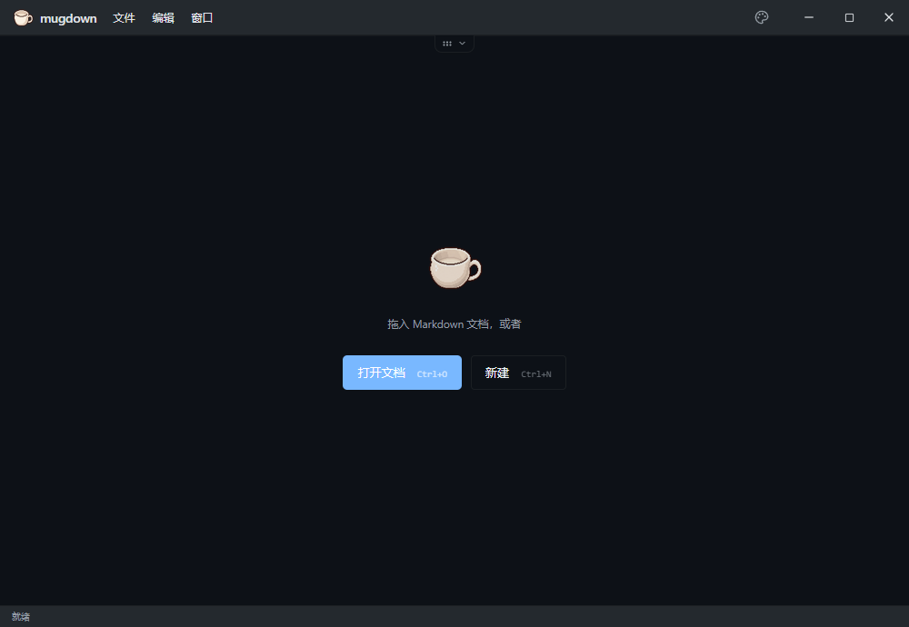
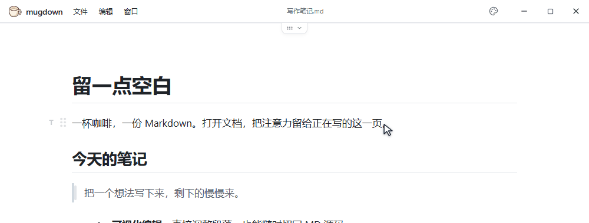
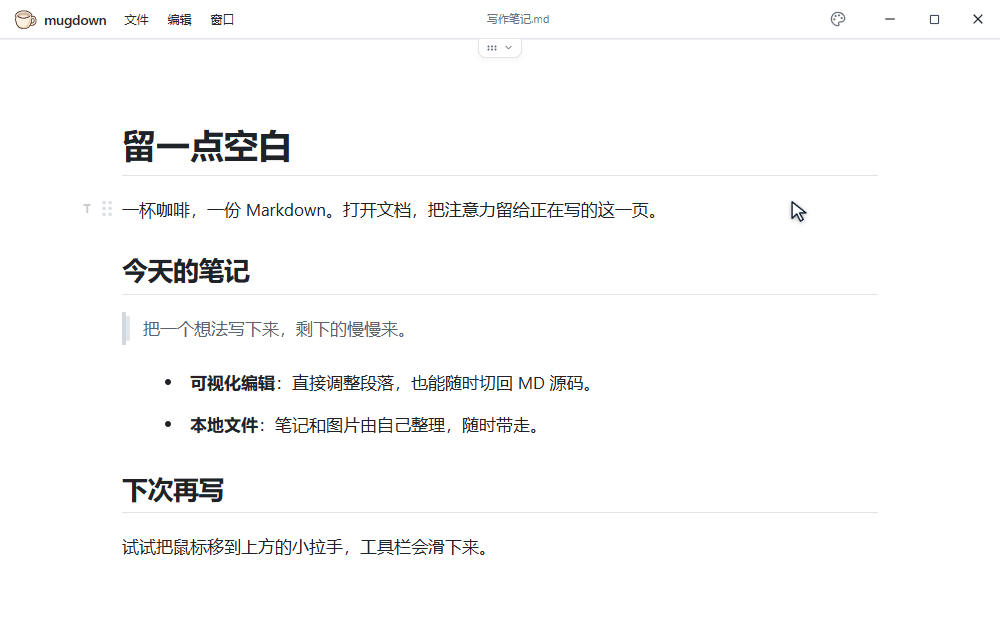
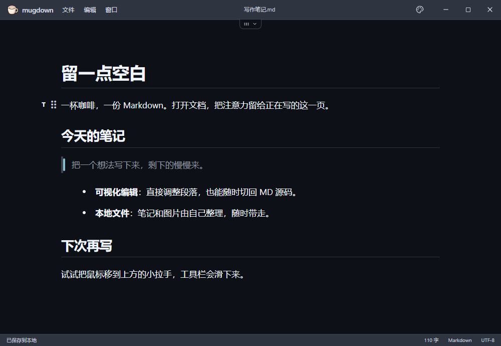
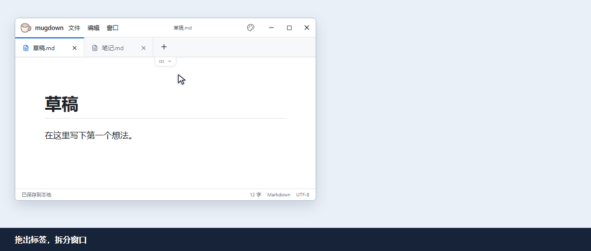

<div align="center">
  
  <h1>mugdown</h1>
  <p>一个极简小巧的本地 Markdown 编辑器，支持 Windows 与 macOS</p>
  <p><strong>Windows x64 便携版 · macOS 通用版 · <a href="README.md">简体中文</a> / <a href="README.en.md">English</a></strong></p>
  <p><a href="https://github.com/winotmk/mugdown/releases/latest"><strong>下载最新版</strong></a> · <a href="#快速开始">快速开始</a> · <a href="#从源码构建">从源码构建</a></p>
</div>



mugdown 是一个小巧的本地 Markdown 编辑器。直接打开、编辑和保存普通 `.md` 文件，不需要账号，也不用导入到专有文档库。窗口默认没有侧栏；只打开一个文档时，标签栏也会让出空间。

Windows x64 的便携 ZIP 约 **2.5 MB**，解压后的主程序约 **4.2 MB**。它使用系统的 WebView2 运行时，发布包不内置浏览器。

| 桌面平台 | 系统 WebView | 当前状态 |
| --- | --- | --- |
| Windows x64 | WebView2 | [便携版可下载](https://github.com/winotmk/mugdown/releases/latest) |
| macOS（Apple Silicon / Intel） | WKWebView | [通用 DMG 可下载](https://github.com/winotmk/mugdown/releases/latest) |
| 图形桌面 Linux | WebKitGTK | 架构可移植，待平台适配和验收 |

## 设计

### 工具栏，用到时再展开

把鼠标移到顶部中央的小拉手，工具栏会滑下来；移开就收起。想让它常驻，点一下图钉即可。选中文字还会出现就近的格式工具。



### 界面皮肤和正文排版独立设置

点右上角的调色板切换界面皮肤。正文排版可以另外选，内置七种预设，也支持自己的 CSS。



<details>
<summary>查看 Nord 深色界面截图</summary>



</details>

### 拖出标签，拆分窗口；拖回标题栏，合并窗口

同时打开两份文档时，把一个标签拖出窗口，就能单独摆放。需要合回去时，拖住独立窗口的标题栏空白处，移到另一个 mugdown 窗口内，看到高亮提示后松手。



## 快速开始

1. 前往 [Releases](https://github.com/winotmk/mugdown/releases)，下载 Windows x64 便携 ZIP。
2. 解压到可写目录，双击 `mugdown.exe`。需要 Microsoft Edge WebView2 运行时；缺少时可从 [微软官网下载](https://developer.microsoft.com/microsoft-edge/webview2/#download-section)。
3. 把 Markdown 文件拖入窗口，或按 <kbd>Ctrl</kbd> + <kbd>O</kbd> 打开。<kbd>Ctrl</kbd> + <kbd>S</kbd> 保存，<kbd>Ctrl</kbd> + <kbd>/</kbd> 切换可视化与 MD 源码。

**Mac**：从同一 Releases 页面下载通用 `.dmg`，打开后将 mugdown 拷贝到「应用程序」。快捷键使用 <kbd>⌘</kbd>，主菜单位于屏幕顶部。签名与安装说明见 [macOS 构建与安装](docs/macos.md)。

- **整理段落**：悬停到段落左侧，点击类型按钮转换格式，或拖住点阵把手调整顺序。
- **编辑 HTML**：Markdown 中的 HTML 会在可视化模式渲染，独立片段带有 `HTML` 标签。可从段落左侧菜单选择「插入 HTML 块」，输入源码后点击「应用」。保存时保留原始 HTML。
- **同时写几份文档**：打开多个文件后会显示标签。拖出标签可以拆成独立窗口；把窗口标题栏拖到另一个 mugdown 窗口中即可合并。
- **保存图片**：粘贴到已保存的文档中，图片会存入文档旁的同名文件夹。移动文档时可以一起带走。
- **Windows 偏好**：默认把 `settings.json` 存在程序旁；也可以在外观设置中改用系统目录。升级便携版时，可将旧设置和个人 `presets` 复制到新目录。
- **Mac 偏好**：默认保存在用户的 Application Support 中，首次修改设置时才生成配置文件。外观设置可打开配置目录，也可切换为 app 旁的 `mugdown-data/` 便携模式。

[添加 Markdown 排版预设](docs/presets.md) · [添加界面语言](docs/i18n.md)

## 架构选择

mugdown 用 **Tauri 2 + Rust** 做桌面外壳，文件读写、窗口、剪贴板和设置由 Rust 接入操作系统。编辑界面使用 **React + TypeScript**；可视化编辑基于 **Milkdown**，源码编辑基于 **CodeMirror**。

同一套编辑界面运行在各平台的[系统 WebView](https://v2.tauri.app/reference/webview-versions/) 中，因此可以复用编辑功能，也省去了在每个安装包里再带一套浏览器。图形桌面 Linux 可以沿用这套架构；窗口拖拽、打开文件夹和配置目录等平台行为仍需适配，目前没有 Linux 安装包。

## 从源码构建

需要 Node.js 24、Rust stable 和 [Tauri 平台构建依赖](https://v2.tauri.app/start/prerequisites/)。在源码目录中运行：

```sh
npm ci
npm test
npm run desktop
```

| 平台 | 打包 |
| --- | --- |
| Windows x64 | `npm run package:win` |
| macOS Universal | 在 Mac 上先运行 `rustup target add aarch64-apple-darwin x86_64-apple-darwin`，再运行 `npm run package:mac` |

Tauri 安装包生成在 `src-tauri/target/<target>/release/bundle/`。Windows 便携 ZIP 可用 PowerShell 脚本生成：

```powershell
./scripts/package-portable.ps1 -ExecutablePath src-tauri/target/x86_64-pc-windows-msvc/release/mugdown.exe
```

Releases 同时提供 Windows x64 便携 ZIP 和 Apple Silicon / Intel 通用 DMG。仓库中的 [构建工作流](.github/workflows/build.yml) 保存构建产物；`main` 上的版本标签在两平台构建与检查通过后，自动发布安装包及 SHA-256 校验文件。

macOS 安装、原生菜单与配置存储说明见 [macOS 构建与安装](docs/macos.md)。

`npm test` 检查文档兼容、编辑历史与语言包；`npm run build` 执行类型检查和生产构建。启动 `npm run dev` 后可运行 `npm run check:ui`，使用本机 Edge 进行界面验收。`cargo test --manifest-path src-tauri/Cargo.toml --release --features custom-protocol` 检查旧设置兼容与新设置保存。原生文件、图片和跨窗口流程由 `scripts/native-smoke.cjs` 在隔离测试目录中验证。

语言配置在 `src/i18n/locales/*.json`，新增文件会自动出现在语言选择器中，具体见 [添加语言](docs/i18n.md)。

图标由内置 imagegen 基于原 Winotypo 图标改为更高、圆润的空杯子；原图保持不变。图标生成记录见 [docs/icon-generation.md](docs/icon-generation.md)，产品范围见 [docs/design.md](docs/design.md)。第三方皮肤、字体与编辑器许可证随发行包保存。

## 仓库目录

| 目录 | 用途 |
| --- | --- |
| [`src/`](src/) | TypeScript 前端。`renderer/` 是桌面界面和编辑器，`shared/` 是 Markdown、主题与编辑历史逻辑，`i18n/` 是界面翻译。 |
| [`src-tauri/`](src-tauri/) | Rust 桌面后端和 Tauri 配置，负责本地文件、窗口、剪贴板与设置；也包含应用图标和权限定义。 |
| [`assets/`](assets/) | 随应用使用的资源，包括图标母版、排版预设和第三方授权说明。 |
| [`docs/`](docs/) | 使用与设计文档、版本说明；`media/` 存放 README 使用的截图和动图。 |
| [`scripts/`](scripts/) | 便携包打包、界面验证、媒体录制和授权文件整理脚本。 |
| [`tests/`](tests/) | Markdown 保真、编辑操作和语言包等自动化测试。 |
| [`.github/workflows/`](.github/workflows/) | GitHub Actions 的 Windows 与 macOS 构建配置。 |

`node_modules/`、`out/`、`src-tauri/target/` 和 `release/` 是依赖或本地构建产物，由安装和打包命令生成。

## 版本发布

- [mugdown v0.2.9](https://github.com/winotmk/mugdown/releases/tag/v0.2.9) — 发布 Mac 通用版，优化原生菜单、窗口按钮与配置存储，支持可选便携模式
- [mugdown v0.2.8](https://github.com/winotmk/mugdown/releases/tag/v0.2.8) — 简化空白页，补充中英文 README 和窗口拆分、合并演示
- [mugdown v0.2.7](https://github.com/winotmk/mugdown/releases/tag/v0.2.7) — 修复 Markdown 与 HTML 混排；支持直接插入并编辑 HTML 块
- [mugdown v0.2.6](https://github.com/winotmk/mugdown/releases/tag/v0.2.6) — Windows x64 便携 ZIP、SHA-256 校验文件和版本说明
- [所有 Releases](https://github.com/winotmk/mugdown/releases)

mugdown 从 Winotypo 的编辑器拆分而来。第三方组件、皮肤和字体的授权说明见 [assets/licenses](assets/licenses/)。
